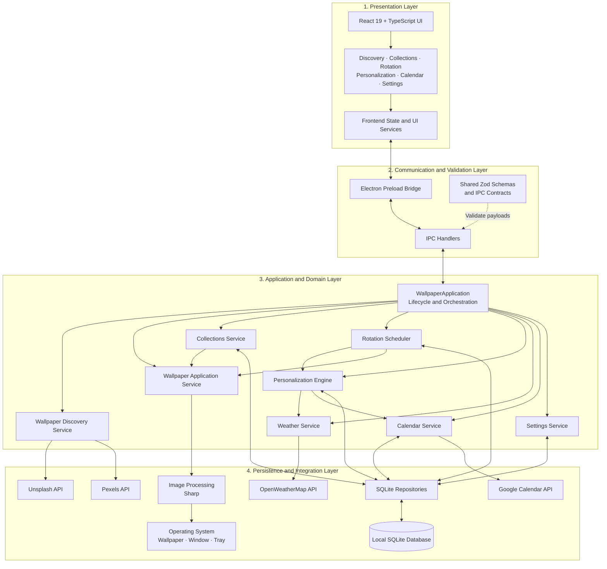
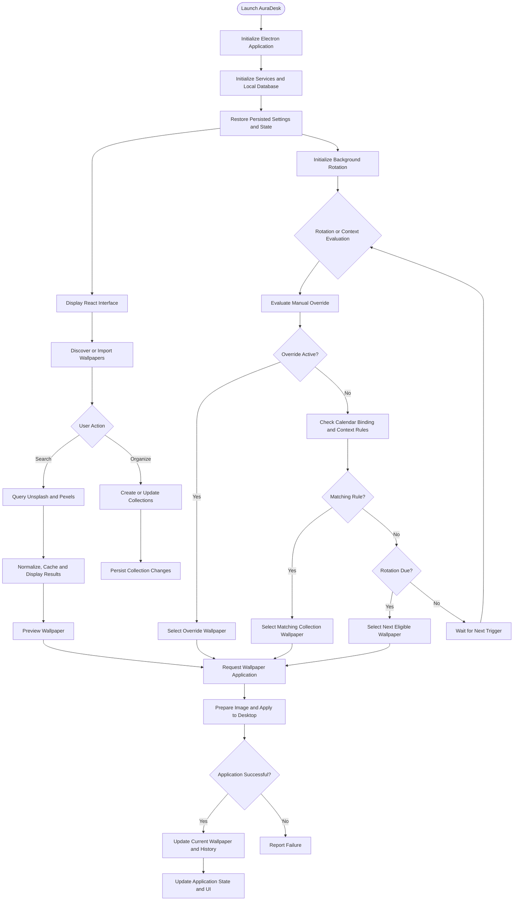

# AuraDesk — The Reality Weaver 🌌

**An intelligent desktop wallpaper engine that transforms your desktop into a living multiverse.**

AuraDesk is a desktop application built for **Softablitz 2026** that combines multi-source wallpaper discovery, desktop wallpaper management, persistent collections, scheduled rotation, and context-aware personalization in a unified experience.

## ✨ What Problem Does It Solve?

Traditional wallpaper applications often rely on manual downloads and repetitive wallpaper changes. They rarely connect wallpaper selection with a user's routines, weather, or calendar.

AuraDesk addresses this by integrating wallpaper discovery, local organization, native desktop operations, and automated contextual selection into one desktop application.

## 🚀 Key Features

### 1. 🌌 Multiversal Wallpaper Discovery

- Search wallpapers from **Unsplash and Pexels**.
- Filter results by provider, orientation, color, and search query.
- Browse curated wallpapers and preview search results.
- Display available image details, photographer credits, and source links.
- Normalize results from multiple providers into a unified format.
- Use caching, controlled concurrency, and provider fallback to improve discovery reliability.

### 2. 🖥️ Instant Wallpaper Manifestation

- Apply selected wallpapers directly to the desktop.
- Resize and crop images to fit the display.
- Preview images before applying them.
- Import custom wallpapers from local storage.
- Track the currently applied wallpaper.
- Record wallpaper history after successful application.

### 3. 🗂️Collections & Vaults

- Create, rename, and delete named wallpaper collections.
- Organize online and local wallpapers into collections.
- Remove and reorder collection items.
- Apply the next or a random wallpaper from a collection.
- Persist collection data locally using SQLite.

### 4. ⏳ Automated Rotation

- Configure wallpaper rotation intervals.
- Enable or pause automatic rotation.
- Rotate through selected collections sequentially or in shuffled order.
- Avoid recently displayed wallpapers when alternatives are available.
- Persist rotation settings and history across restarts.
- Prevent overlapping rotation operations.
- Track rotation status and the next scheduled change where available.

### 5. 👁️ Context-Aware Personalization

- Create personalization rules based on time ranges, weather, and day parts.
- Associate rules with wallpaper collections.
- Assign priorities to resolve conflicting rules.
- Automatically select wallpapers using the current context.
- Support manual overrides that take priority over automatic selection.
- Restore persisted overrides and simulate contexts for testing and demonstrations.

### 6. 🌦️ Weather & Atmospheric Intelligence

- Retrieve current weather and temperature through OpenWeatherMap.
- Classify conditions such as clear skies, clouds, rain, snow, thunderstorms, and mist.
- Use sunrise and sunset information to derive day/night context.
- Cache weather information to reduce unnecessary requests.
- Match weather conditions against personalization rules.

### 7. 📅 Calendar-Based Wallpaper Scheduling

- Connect Google Calendar through OAuth 2.0.
- Retrieve upcoming events and maintain local event data.
- Associate event IDs or keywords with wallpaper collections.
- Prioritize a matching collection when an associated event is active.
- Refresh calendar information periodically.
- Retain integration state across application restarts.
- Support simulated calendar contexts for testing.

### 8. 🔄 Persistent Automation & System Tray

- Keep background scheduling active when the application window is closed or minimized, according to the application's window lifecycle.
- Control rotation and automation through system-tray functionality.
- Restore persisted settings and rotation history on startup.
- Support launch-on-login configuration.
- Send UI updates and notifications for relevant wallpaper, rotation, calendar, network, and error events where implemented.

### 9. 🎨 Premium Desktop Experience

- Modern, macOS-inspired interface with glass-inspired styling.
- Dedicated views for wallpaper discovery, collections, personalization, rotation history, calendar integration, and settings.
- Curated categories such as nature, minimalism, cyberpunk, architecture, space, abstract glass, and rainy atmospheres.
- Wallpaper cards with previews and available image information.
- Desktop simulator and current-wallpaper presentation.
- Light and dark appearance options where supported by the interface.

### 10. 🛡️ Reliability, Security & Extensibility

- Electron main-process and React renderer separation.
- Restricted renderer-to-main communication through a preload bridge.
- SQLite persistence and database migrations.
- Zod-based validation for supported IPC inputs.
- API timeouts, retries, caching, and controlled concurrency.
- Environment-based API configuration.
- Secure-storage integration for sensitive desktop credentials where supported.
- Modular services, repositories, and shared types for maintainability.

*Note: Collection export/import and any other partially implemented interface elements should be verified against the current implementation before being presented as completed features.*

## 🏗️ System Architecture

AuraDesk follows a **layered desktop architecture**. The Electron main process acts as the application's orchestration layer, while the React renderer handles the user interface. A controlled preload bridge exposes approved operations to the frontend without granting it unrestricted Node.js access.

### Architecture Diagram



### Architecture Layers and Responsibilities

| Layer                        | Main components                                                                                                    | Responsibility                                                                                                |
| ---------------------------- | ------------------------------------------------------------------------------------------------------------------ | ------------------------------------------------------------------------------------------------------------- |
| Presentation                 | React, TypeScript, frontend components and state                                                                   | Displays wallpapers, collects user actions, and reflects application state.                                   |
| Communication                | Preload bridge, IPC handlers, shared schemas                                                                       | Exposes approved desktop operations and validates supported messages between processes.                       |
| Application and domain       | `WallpaperApplication`, discovery, wallpaper, collections, scheduler, personalization, weather, calendar, settings | Coordinates feature workflows and applies application rules.                                                  |
| Persistence and integrations | SQLite repositories, OS integrations, image processing, external APIs                                              | Stores durable data, performs desktop operations, processes images, and communicates with external providers. |

### Core Component Responsibilities

- **`WallpaperApplication`** — Coordinates application startup, window lifecycle, and initialization of the main application services.
- **Discovery service** — Queries Unsplash and Pexels, normalizes results, manages discovery caching, and handles provider failures.
- **Wallpaper service** — Coordinates wallpaper preparation and applying images to the operating system.
- **Collections service** — Manages named collections and their wallpaper entries.
- **Rotation scheduler** — Evaluates rotation timing, selects eligible wallpapers, and coordinates automatic changes.
- **Personalization engine** — Evaluates manual overrides, calendar bindings, and contextual rules to determine wallpaper selection.
- **Weather and calendar services** — Retrieve environmental and event context from their respective external providers.
- **Settings service and repositories** — Manage persisted preferences and provide database-backed access to application data.
- **Preload and IPC layer** — Defines the boundary through which the renderer requests privileged desktop operations.

### Important Architectural Decisions

**1. Renderer–main process separation**

The React renderer focuses on presentation. Privileged tasks, such as desktop wallpaper changes, local database access, and operating-system integrations, are handled by the Electron main process through approved IPC operations.

**2. Local-first persistence**

SQLite stores application data such as collections, settings, and rotation-related records according to the implemented repository schemas. This keeps local organization available without requiring every operation to depend on a remote service.

**3. Service-oriented design**

Discovery, wallpaper application, rotation, personalization, weather, calendar, and settings are separated into services. This makes individual workflows easier to maintain and test.

**4. Context-driven selection**

Personalization combines available context with configured rules. The selection logic gives manual overrides precedence, then checks applicable calendar bindings and contextual rules before falling back to scheduled rotation or a default selection.

**5. Resilient external integrations**

Discovery uses normalized provider results, bounded concurrency, caching, and fallback handling. Weather and calendar functionality depend on their external APIs and valid credentials, so those integrations may be unavailable offline.

## 🔄 Application Workflow



## 🧰 Tech Stack

| Layer                         | Technologies                                      |
| ----------------------------- | ------------------------------------------------- |
| Desktop framework             | Electron 34                                       |
| Frontend                      | React 19, TypeScript, Vite                        |
| Styling and icons             | Tailwind CSS 4, Lucide React                      |
| Runtime                       | Node.js in Electron's main process                |
| Database                      | SQLite, `better-sqlite3`                          |
| Image processing              | Sharp                                             |
| Desktop wallpaper integration | `wallpaper` package                               |
| Scheduling                    | `node-cron`                                       |
| External APIs                 | Unsplash, Pexels, OpenWeatherMap, Google Calendar |
| Networking and resilience     | Axios, axios-retry, p-limit                       |
| Validation                    | Zod                                               |
| Desktop communication         | Electron IPC and `contextBridge`                  |
| Packaging                     | electron-builder                                  |
| Configuration                 | dotenv                                            |

## 📁 Project Structure

```text
AuraDesk/
├── build/
│   └── icon.png
├── docs/
│   ├── api/                       # API and IPC documentation
│   ├── architecture/              # Architecture documentation
│   └── tasks/                     # Implementation guides
├── electron/
│   ├── main/
│   │   ├── database/
│   │   │   ├── migrations/        # Database schema migrations
│   │   │   └── repositories/      # Persistent data access
│   │   ├── ipc/
│   │   │   └── handlers/          # Main-process IPC handlers
│   │   ├── services/
│   │   │   ├── app/               # Application lifecycle
│   │   │   ├── discovery/         # Wallpaper provider integration
│   │   │   ├── wallpaper/         # Wallpaper application
│   │   │   ├── collections/       # Collection management
│   │   │   ├── scheduler/         # Rotation scheduling
│   │   │   ├── personalization/   # Context-aware selection
│   │   │   ├── weather/           # Weather integration
│   │   │   ├── calendar/          # Calendar integration
│   │   │   └── settings/          # Application preferences
│   │   ├── tray/                  # System-tray functionality
│   │   └── index.js               # Electron entry point
│   └── preload/                   # Restricted renderer bridge
├── frontend/
│   ├── public/                    # Static assets
│   └── src/
│       ├── components/            # Feature UI components
│       ├── context/               # Frontend application state
│       ├── services/              # Electron bridge
│       ├── utils/                 # Helpers and tests
│       ├── types/                 # Frontend types
│       ├── App.tsx                # Root UI component
│       └── main.tsx               # Frontend entry point
├── shared/
│   ├── constants/                 # Shared constants
│   ├── schemas/                   # Validation schemas
│   └── types/                     # Shared types
├── tests/                         # Automated tests
├── .env.example                   # Environment variable template
├── package.json                   # Root scripts and dependencies
└── README.md
```

## ⚙️ Getting Started

### Prerequisites

- Node.js and npm
- Git
- A supported desktop environment
- API credentials for the integrations you want to use

### 1. Clone the repository

```bash
git clone <YOUR_REPOSITORY_URL>
cd AuraDesk
```

If your cloned directory is named `AuraDesk-main`, change into that directory instead.

### 2. Install dependencies

Run these commands from the repository root:

```bash
npm run install:all
npm run rebuild
```

The rebuild step installs the application's native dependencies for Electron.

### 3. Configure environment variables

Copy `.env.example` to `.env` in the repository root and configure the integrations you intend to use.

```env
UNSPLASH_ACCESS_KEY=your_unsplash_access_key
PEXELS_API_KEY=your_pexels_api_key
OPENWEATHER_API_KEY=your_openweathermap_api_key
GOOGLE_CLIENT_ID=your_google_client_id
GOOGLE_CLIENT_SECRET=your_google_client_secret
```

- Obtain an Unsplash access key from the Unsplash developer platform.
- Obtain a Pexels API key from the Pexels developer platform.
- Obtain an OpenWeatherMap API key for weather functionality.
- Configure a Google OAuth client and the required consent settings for Calendar integration.

**Security:** Never commit `.env` or real credentials to version control. Keep `.env.example` limited to placeholder values.

### 4. Run in development mode

```bash
npm run dev
```

The root script starts the Vite frontend and launches Electron after the frontend server becomes available.

### 5. Build the application

Build the frontend and package the application:

```bash
npm run build
```

Build a Windows installer:

```bash
npm run build:win
```

Build a macOS disk image:

```bash
npm run build:mac
```

Build an unpacked application directory:

```bash
npm run build:dir
```

Builds should be tested on the target operating system, especially for native dependencies and desktop wallpaper operations.

### 6. Run tests

Run the standard test suite:

```bash
npm test
```

Run the broader test suite:

```bash
npm run test:
```
