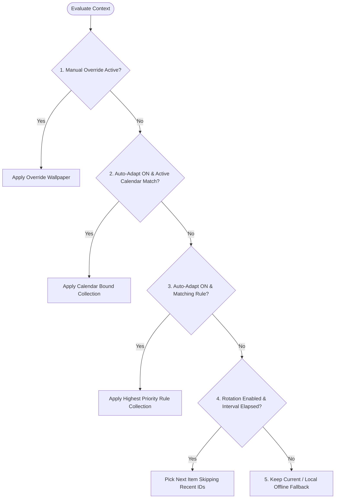

# System Design & Model Architecture

This document describes the runtime services, data models, lifecycle management, and architectural decisions of **AuraDesk**.

---

## 1. Core Classes & Models (Part 1)

### 1.1 Application & Settings
- **`WallpaperApplication` (Runtime)**
  - *Role*: Root of the Electron main process. Boots services, owns lifecycle, registers IPC.
  - *Fields*: `settings: AppSettings`, `isRunning: Boolean`
  - *Methods*:
    - `start()`: Initializes database, runs migrations, spins up services, registers IPC handlers, creates main window + system tray, restores scheduler state.
    - `shutdown()`: Stops scheduler, flushes DB WAL, destroys system tray.
    - `minimizeToTray()`: Hides the main window while keeping scheduler alive.
- **`AppSettings` (SQLite: `settings`)**
  - *Role*: Key-value app configuration, loaded once and cached in memory.
  - *Fields*: `rotationInterval: Integer (min)`, `shuffleEnabled: Boolean`, `autoAdaptEnabled: Boolean`, `location: Object`, `launchOnStartup: Boolean`, `sourcesEnabled: Object`.
  - *Methods*: `load()`, `save()`.

---

### 1.2 Discovery Services
- **`WallpaperDiscoveryService` (Runtime)**
  - *Role*: Single entry point for online discovery; queries provider adapters concurrently and aggregates results.
  - *Fields*: `sources: List<WallpaperSource>`
  - *Methods*:
    - `search(query, filters)`: Queries enabled sources, normalizes to `Wallpaper[]`, dedupes, paginates.
    - `getPreview(id)`: Resolves preview-size URL or cached temporary file.
    - `getSourceCredits(id)`: Returns photographer attribution, profile link, and source details.
- **`WallpaperSource` (Interface)**
  - *Role*: Provider adapter contract implemented by `UnsplashSource` and `PexelsSource`.
  - *Fields*: `name: String`, `baseUrl: String`, `apiKey: String` (loaded via `.env`).
  - *Methods*:
    - `search(query, filters)`: Invokes provider API with timeout and retries.
    - `fetchWallpaper(id)`: Fetches complete image metadata with high-res URLs.
    - `getCredits(id)`: Returns attribution fields.
    - `trackDownload(id)`: Pings provider download endpoint when applied (mandatory for Unsplash compliance).
- **`Wallpaper` (SQLite: `wallpapers`)**
  - *Role*: Normalized wallpaper record (both online cached metadata and local files).
  - *Fields*: `id: String` (`'unsplash:<id>'`, `'pexels:<id>'`, `'local:<uuid>'`), `source: String`, `title: String`, `description: String`, `imageUrl: String`, `thumbUrl: String`, `photographer: String`, `creditUrl: String`, `width: Integer`, `height: Integer`, `localPath: String?`, `cachedAt: DateTime`.
  - *Methods*: `getPreview()`, `getAspectRatio()`.

---

### 1.3 Collections (Sanctum of Memories)
- **`WallpaperCollection` (SQLite: `collections`)**
  - *Role*: Named vault of wallpapers containing both online images and local files.
  - *Fields*: `id: UUID (String)`, `name: String (unique)`, `createdAt: DateTime`, `updatedAt: DateTime`.
  - *Methods*:
    - `addWallpaper(w)`: Inserts a `collection_items` join row at the end position; dedupes.
    - `removeWallpaper(w)`: Deletes the item row and closes the position gap.
    - `getWallpapers()`: Returns ordered items joined with wallpaper records.
- **`CollectionItem` (SQLite: `collection_items`)**
  - *Role*: Join row between collection and wallpaper with ordering.
  - *Fields*: `id: Integer PK`, `collectionId: UUID`, `wallpaperId: String`, `position: Integer`, `addedAt: DateTime`.
  - *Methods*: `updatePosition(n)` (transactional reorder).

---

### 1.4 Desktop Integration
- **`WallpaperManager` (Runtime)**
  - *Role*: The only class allowed to touch the OS desktop wallpaper. Isolates platform differences.
  - *Fields*: `currentWallpaper: Wallpaper`
  - *Methods*:
    - `preview(w)`: Downloads regular-size image to temp cache and returns path (desktop is NOT changed).
    - `apply(w)`: Fetches full image, calls `scaleAndCrop()`, applies via `wallpaper.setWallpaper()`, and logs history only upon success.
    - `scaleAndCrop()`: Uses `Sharp` to resize image to `displaySize * scaleFactor`, applies `fit: 'cover'`, writes to a temporary file, and cleans up after apply.
- **`SystemTrayController` (Runtime)**
  - *Role*: System tray icon + context menu so automation continues when window is closed.
  - *Methods*: `showMenu()`, `handleAction()`, `keepAlive()` (prevents app quit on window close).

---

### 1.5 Rotation & History (Time Stone)
- **`RotationScheduler` (Runtime)**
  - *Role*: Single coordinated scheduler running a `node-cron` tick every minute (`* * * * *`). Checks if `intervalMinutes` has elapsed since `last_run_at`.
  - *Fields*: `intervalMinutes: Integer`, `enabled: Boolean`, `shuffle: Boolean`, `isRotating: Boolean` (re-entrancy lock).
  - *Methods*: `scheduleNext()`, `rotateNow()`, `pause()`, `resume()`.
- **`RotationHistory` (SQLite View / Service)**
  - *Fields*: `entries: List<HistoryEntry>`
  - *Methods*:
    - `record(w, time)`: Inserts row upon successful wallpaper application.
    - `getRecentIds()`: Returns last $N$ wallpaper IDs ($N = \min(10, \text{collection size} - 1)$) to prevent immediate repetition.
    - `restoreState()`: Restores last applied wallpaper and `last_run_at` on startup.
- **`HistoryEntry` (SQLite: `rotation_history`)**
  - *Fields*: `id: Integer PK`, `wallpaperId: String`, `appliedAt: DateTime`, `trigger: String` (`MANUAL` | `ROTATION` | `RULE` | `CALENDAR`), `collectionId?: UUID`, `ruleId?: UUID`.
  - *Methods*: `wasRecentlyUsed()`.

---

### 1.6 Context-Aware Personalization (Eye of Agamotto)
- **`PersonalizationEngine` (Runtime)**
  - *Role*: Evaluates the context to decide which wallpaper should be displayed.
  - *Fields*: `enabled: Boolean`, `override: { wallpaperId, expiresAt? }`
  - *Methods*:
    - `chooseWallpaper(context)`: Executes priority chain: `Manual Override > Calendar Binding > Personalization Rule > Rotation > Keep Current`.
    - `evaluateRules()`: Sorts enabled rules by priority and returns the first match.
    - `manualOverride(w)`: Sets override and persists to SQLite so it survives app restarts.
- **`PersonalizationRule` (SQLite: `personalization_rules`)**
  - *Fields*: `id: String PK`, `name: String`, `conditionType: RuleConditionType` (`TIME_RANGE` | `WEATHER` | `DAY_PART`), `conditionValue: JSON`, `collectionId: UUID`, `priority: Integer`, `enabled: Boolean`.
  - *Methods*: `matches(context)`, `getTargetCollection()`.
- **`WeatherService` (Runtime + Cache)**
  - *Role*: OpenWeatherMap client with a **10-minute in-memory cache**.
  - *Methods*: `getCurrentWeather()`, `getCondition()`, `setLocation()`.
- **`CalendarService` (Runtime + Cache)**
  - *Role*: Google Calendar client using OAuth loopback + PKCE. Polls upcoming events every 5 minutes.
  - *Methods*: `fetchUpcomingEvents()`, `getNextEvent()`.
- **`CalendarEvent` (SQLite: `calendar_events_cache`)**
  - *Fields*: `id: String PK`, `title: String`, `startTime: DateTime`, `endTime: DateTime`, `fetchedAt: DateTime`.
  - *Methods*: `isActive(now)`, `timeUntilStart()`.

---

### 1.7 Added Models (From Specification Additions)
1. **`CalendarBinding` (SQLite: `calendar_bindings`)**: Links calendar keywords or event IDs to specific collections (e.g., event title contains `"Exam"` $\to$ triggers `"Study/Focus"` collection).
2. **`OverrideState` (SQLite: `overrides`)**: Single-row persistence (`wallpaper_id`, `set_at`, `expires_at`) allowing manual overrides to survive restarts.
3. **`ContextSnapshot` (In-memory)**: `{ now, weather, activeEvent, isDay }`. Built once per scheduler tick so all rules evaluate against the same frozen context.
4. **`RotationConfig` (SQLite: `rotation_config`)**: Unified single-row configuration for rotation interval, shuffle flag, selected collection IDs, and last run timestamp.

---

## 2. Decision Priority Chain

When determining which wallpaper to display, `PersonalizationEngine.chooseWallpaper(context)` follows this strict order:



| Order | Source | Condition |
| :---: | :--- | :--- |
| **1** | **Manual Override** | Override row exists and has not expired. Always wins, even if auto-adapt is disabled. |
| **2** | **Calendar Binding** | `autoAdaptEnabled` is true and an active `CalendarEvent` matches a defined keyword/binding. |
| **3** | **Personalization Rule** | `autoAdaptEnabled` is true and highest-priority enabled rule matches context (time/weather). |
| **4** | **Rotation** | Rotation is enabled and interval has elapsed: selects next item from active collections, skipping recently used IDs. |
| **5** | **Fallback** | Anything fails or no match: retain current wallpaper. If network/APIs are down, fall back to local collections only. |

---

## 3. Scale and Crop Recipe (`WallpaperManager`)

To eliminate OS-level image distortion and ensure crisp displays:
1. Fetch primary display dimensions from Electron's `screen` module.
2. Multiply logical width and height by `scaleFactor`.
3. Resize with Sharp using `fit: 'cover'` and `position: 'attention'` (or center).
4. Save as high-quality JPEG to temporary folder (`app.getPath('temp')/auradesk/`).
5. Apply wallpaper via `wallpaper.setWallpaper(tmpPath)`.
6. Write to `rotation_history` **only** upon success, then delete the temporary file.

```javascript
const d = screen.getPrimaryDisplay();
const w = Math.round(d.size.width * d.scaleFactor);
const h = Math.round(d.size.height * d.scaleFactor);

await sharp(inputBufferOrPath)
  .resize(w, h, { fit: 'cover', position: 'attention' })
  .jpeg({ quality: 90 })
  .toFile(tmpPath);

const { setWallpaper } = await import('wallpaper');
await setWallpaper(tmpPath);
await rotationHistory.record(wallpaper, 'MANUAL');
await fs.promises.unlink(tmpPath);
```

---

## 4. Electron Main Process Security Standards

- **Window Isolation**:
  ```javascript
  new BrowserWindow({
    webPreferences: {
      contextIsolation: true,
      nodeIntegration: false,
      sandbox: true,
      preload: path.join(__dirname, '../preload/index.js')
    }
  });
  ```
- **Context Bridge**: Expose only explicit functions (`window.api.invoke` / `window.api.on`). Never expose `ipcRenderer` directly.
- **Payload Validation**: Every IPC payload received in the main process must be validated against its corresponding `zod` schema before processing.
- **Safe Storage**: Google OAuth tokens and credentials must be encrypted using Electron's native `safeStorage.encryptString()`, never stored in plaintext SQLite.
- **External Links**: `app:openExternal` strictly restricts URLs to `https://` protocols to prevent arbitrary scheme execution.
