# Conventions, Build Order & Contest Roadmap

> **Competition**: Softablitz 2026 — Problem Statement: The Reality Weaver  
> This document details the software development conventions, feature breakdown across contest tiers, and the suggested 8-milestone build plan.

---

## 1. System Conventions & Engineering Rules

### 1.1 IPC & Error Handling
- Every IPC handler must return the standard envelope: `{ ok, data, error: { code, message } }`.
- Allowed error codes:
  - `VALIDATION`: Payload failed Zod schema checks.
  - `NOT_FOUND`: Wallpaper, collection, or rule ID does not exist.
  - `RATE_LIMITED`: External API exceeded quota.
  - `OFFLINE`: Network is unreachable; system falls back to local files.
  - `APPLY_FAILED`: OS denied wallpaper set permission or file corrupt.
  - `AUTH_REQUIRED`: Google Calendar session expired or missing tokens.

### 1.2 Desktop Integration & History
- **Atomicity**: `rotation_history` is written **only after** `wallpaper.setWallpaper()` successfully resolves. A failed apply must never count as "recently used".
- **Single Scheduler**: Exactly one `node-cron` instance runs in the main process. Guard `rotateNow()` with an `isRotating` boolean flag so manual tray clicks and scheduled cron ticks cannot collide or double-fire.
- **No-Repeat Window**: The scheduler must skip the last $N$ wallpaper IDs, where $N = \min(10, \text{collection size} - 1)$.

### 1.3 Networking & Resilience
- Shared Axios instances with 8–10 second timeouts.
- Maximum 2 retries with exponential backoff on network failures and `429` / `5xx` responses. **Never retry 4xx client errors**.
- Automatic failover from Unsplash to Pexels upon encountering rate limits (`403` / `429`).

### 1.4 File Hygiene
- Temporary files must be written to `app.getPath('temp')/auradesk/`.
- Temporary files are deleted immediately after wallpaper application.
- The temp folder is swept and cleared on app startup.
- Never load full-resolution images into renderer memory.
- For local files: Always check `fs.existsSync(localPath)` before applying. Skip missing files gracefully.

---

## 2. Contest Tiers Mapping (Softablitz Rules 6 & 7)

| Tier | Statement Feature | Functionality | Channels / Components |
| :--- | :--- | :--- | :--- |
| **Basic B1** | **Multiversal Portal** | Search, filter, preview, photographer credits | `discovery:*`, preview modal |
| **Basic B2** | **Reality Manifestation** | Sharp scale & crop, apply to desktop OS | `wallpaper:apply`, `wallpaper:displays`, `WallpaperManager` |
| **Basic B3** | **Sanctum of Memories** | Named vaults, online + local images, shuffle/cycle | `collection:*`, `collection:apply` |
| **Advanced A1** | **Eye of Agamotto** | Time & weather rules, auto-adapt toggle, manual override | `rule:*`, `personalization:*`, `weather:*` |
| **Advanced A2** | **Time Stone** | Calendar events trigger, rotation, no-repeat, tray persistence | `calendar:*`, `rotation:*`, `SystemTrayController` |
| **Bonus** | **Share Collections** | Export & import collection vaults via JSON file | `collection:export`, `collection:import` |

---

## 3. Suggested 8-Milestone Build Order

```mermaid
gantt
    title AuraDesk Implementation Timeline
    dateFormat  X
    axisFormat %s
    section Milestone
    1. Skeleton & DB Engine       :0, 1
    2. Discovery UI & Providers   :1, 2
    3. Sharp Crop & Apply Engine  :2, 3
    4. Collection Vaults (B1-B3)  :3, 4
    5. Rotation & Tray Automation :4, 5
    6. Personalization & Weather  :5, 6
    7. Calendar OAuth & Sync      :6, 7
    8. Polish & Demo Script       :7, 8
```

| # | Milestone | Core Tasks | Definition of Done |
| :---: | :--- | :--- | :--- |
| **1** | **Skeleton** | Electron main/preload split, React+Vite, Zod, SQLite migrations, standard error envelope. | Renderer can call `settings:get` and read a SQLite-backed default value. |
| **2** | **Discovery** | `UnsplashSource` + `PexelsSource`, search/filter bar, grid UI, preview modal with photographer attribution. | Search returns normalized items across both providers with responsive thumbnail layout. |
| **3** | **Apply** | `WallpaperManager` (Sharp crop/scale for primary display), `wallpaper.setWallpaper()`, history record. | Clicking "Apply" sets the desktop wallpaper with precise aspect-ratio cropping on Windows. |
| **4** | **Collections** | Vaults CRUD, local file picker dialog, drag-and-drop reordering, collection apply (shuffle/cycle). | **Basic Tier (B1–B3) Complete!** Stop and perform a demo sanity check. |
| **5** | **Rotation & Tray** | `node-cron` tick, no-repeat logic, minimize-to-tray, auto-launch on startup, `restoreState()`. | Closing window keeps scheduler running. App quit & reopen restores interval and last active wallpaper. |
| **6** | **Personalization** | `WeatherService` (10-min cache), rule builder UI, override toggle, priority chain evaluation. | Rain or Night rule automatically selects target collection. Manual override beats rule. |
| **7** | **Calendar** | Google OAuth loopback + PKCE, event cache, keyword bindings (e.g. "meeting" triggers "Clean" collection). | Upcoming test meeting triggers designated wallpaper collection switch. |
| **8** | **Polish & Packaging** | Collection JSON export/import, toast notifications, offline badge, `electron-builder` installers. | Production installer packages smoothly; demo rehearsal complete with mock context switch. |

---

## 4. Risks & Early Mitigations

1. **API Keys Activation**: OpenWeatherMap and Google Cloud OAuth credentials can take hours or days to approve. Keys should be generated on Day 1.
2. **Native Module Builds**: `better-sqlite3` and `sharp` are native modules compiled for Electron. Never postpone building installer packages until the deadline—test packaged builds starting at Milestone 1.
3. **Demo Day Reliability (Mock Context Switch)**: Live weather or calendar events may not occur during judging presentations. Implement a hidden **Mock Context Switch** in the UI to simulate rain, night, or an immediate calendar event for flawless demonstrations.
